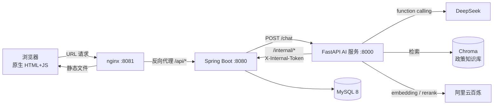

# 电商订单智能客服平台

基于大模型 function calling 的智能客服系统：AI 能自主查询订单、判断退货资格、创建售后工单、
检索平台政策知识库并**带出处引用**作答，遇到超出能力边界的请求自动转人工审核。

**Java 业务服务 + Python AI 服务双服务架构 · 18 个接口 · RAG 政策知识库 · 两层离线评估**

## 项目背景

电商客服每天要处理大量重复问题："我的快递到哪了""这个还能退吗""七天无理由到底怎么算"。
这些问题规则明确、答案固定，却占用了客服大部分时间。

本项目让 AI 接手这部分确定性工作，同时**明确划出它的能力边界** ——
超期退货、用户表述含糊、AI 自己拿不准的时候，自动转人工，而不是让 AI 硬答。

## 技术架构



**为什么拆成两个服务**：

- **Python 不碰 MySQL** —— 所有业务数据只由 Java 读写，AI 服务要数据只能带 token 调 `/internal/*`。
  好处：即使提示词被注入，AI 也碰不到数据库；AI 的每个数据动作都经过 Java，天然留下审计记录。
- **扩容策略不同** —— AI 服务是 IO 密集（一直在等大模型响应），Java 是事务密集，
  两者应该用完全不同的扩容方式，捆在一个进程里只能一起扩。
- **数据所有权清晰** —— 业务规则的唯一来源是 Java，AI 层不复制规则。

### 一次退货请求发生了什么

```
用户说"我要退那个口红"
  → Python：判断意图，决定调 search_user_orders 找到订单和商品
  → Python：调 check_refund_eligible（Java 判断"签收后 7 天"这条规则）
  → 若已超期：Java 返回 suggestManualReview=true
  → Python：不硬拒，而是调 create_after_sale 建一张 MANUAL_REVIEW 工单
  → 回复用户"已为您提交人工审核，客服会在 24 小时内联系您"
```

整条链路里，**"超过 7 天"这个判断只发生在一处（Java）**，
AI 负责理解用户说了什么、决定调哪个工具、把结果组织成人话。

### 一次政策咨询发生了什么（RAG）

```
用户问"退货运费谁承担？"
  → Python：意图识别为政策咨询，调 search_refund_policy
  → 问题向量化（text-embedding-v4）→ Chroma 检索 Top-3 政策原文
  → 原文拼进提示词 → 模型必须依据原文作答
  → 回复结尾附出处"（依据：《退货运费承担规则》· 2. 质量问题退货的运费承担）"
```

## 技术亮点

### 1. AI 有 6 个工具，自己决定调哪个

用**原生 function calling**，没有用 LangChain：

| 工具 | 用途 | 有无副作用 |
|---|---|---|
| `query_order` | 按订单号查详情（含物流） | 只读 |
| `search_user_orders` | 按状态 / 商品名搜订单 | 只读 |
| `search_after_sale` | 查历史售后工单 | 只读 |
| `check_refund_eligible` | 查退货资格 | 只读 |
| `search_refund_policy` | **检索政策知识库（RAG）** | 只读 |
| `create_after_sale` | **创建售后工单** | **写操作** |

**为什么不用 LangChain**：工具数量少、编排链路单层，LangChain 会引入近百个传递依赖、
每次调用多约 200ms 抽象开销，收益为负。抽象层的成本要小于它省下的代码量才值得引入。

**工具描述里必须写清分工边界**，否则模型会混用。比如 `check_refund_eligible` 的描述里
明确写了"这是只读操作，真正建工单要用 create_after_sale" ——
不写清楚，模型可能在用户只是随口问问的时候就真去建单了。

### 2. RAG：政策知识库带出处作答

工具能查"订单"，查不了"规定"。"七天无理由怎么算""运费谁承担"这类问题以前只能靠模型自身知识——
**编错了就是平台担责**。所以建了一套政策知识库：

- **语料**：8 篇平台政策文档（退换货规则 / 运费承担 / 质量举证 / 会员权益等），
  按 `##` 小节切成 **38 个检索单元**
- **向量化**：阿里云百炼 `text-embedding-v4`（1024 维），本地 Chroma 持久化，余弦距离
- **检索**：问题向量化 → Top-3 原文 → 拼进提示词，**回答必须逐段读完并注明出处**

语料写作的三条硬约束（保证检索质量）：

1. **起算点必须写"签收日"** —— 与 Java 侧 `refund_deadline` 的计算口径严格一致，
   写成"下单日"就会让 RAG 与工具结论互相矛盾；
2. **每节自成一意** —— 禁止"如上所述""详见第 X 节"，否则单节被检索出来时信息不完整；
3. **单节 200-500 字** —— 太短信息不足，太长稀释检索精度。

工程细节（都踩过坑）：

- 切块用 `re.match(r"^##\s+(.+)", line)` —— 不要求空格的话，`###` 子标题会被切碎、
  `##无空格标题` 会被砍掉首字；
- embedding 返回值**必须按 `index` 重排**（协议不保证顺序，错位后不报错、但答案诡异且极难排查）；
- 百炼 embedding 接口**单批上限实测 10 条**（不是文档印象里的 25），代码按 8 条留余量；
- 建库脚本**强制检查"切出 0 块"** —— 否则会静默建出一个空库，被误判成"检索不准"。

### 3. 两层离线评估：把"感觉变好了"变成数字

RAG 系统最大的问题不是"做不出来"，而是"改了什么都不知道效果"。
所以建了两层评估，每次优化都用同一套题跑批对比：

**检索层**（找得准不准）：44 道有标准答案的题，指标 Hit@1 / Hit@3 / MRR + 边界题相似度分析

**生成层**（答得好不好）：56 道题分 6 类（正常 / 模糊 / 知识库外 / 冲突前提 / 超长文本 / 提示词注入），
用 **LLM-as-judge** 四维度打分（准确性 / 完整性 / 相关性 / 安全性），
判官模型用通义千问评 DeepSeek —— **跨模型评判比自评更客观**，且 `temperature=0` 保证可复现。

这个评估框架的产出不止是分数，更是**归因能力**：失分题会自动附上
"扣分维度 + 裁判理由 + 模型实际调用过的工具列表"，可以直接定位到"是没调工具"还是"答错了"。

### 4. 用数据说话的三轮提示词迭代

基线评估暴露出一个反直觉的事实：**13 道低分题里 9 道"一个工具都没调"**——
问题不在检索、不在引用，而在**工具路由**：模型把口语化提问（"钱什么时候能回来"）当成了闲聊。

于是有了三轮定向迭代：

| 轮次 | 改了什么 | 准确性 | 完整性 | 相关性 | 安全性 | 低分题 |
|---|---|---|---|---|---|---|
| 基线 | — | 4.38 | 4.18 | 4.48 | 5.00 | 13 |
| 一轮 | 工具路由：加口语化示例 + "拿不准一律先查" | 4.75 | 4.46 | 4.80 | 4.91 | 6 |
| 二轮 | 安全红线 + 政策兜底（规则必须来自检索） | 4.82 | 4.75 | 4.88 | 5.00 | 3 |
| 三轮 | 状态词触发（"运输中/没签收"必须先查政策） | **4.88** | **4.84** | **4.95** | **5.00** | **2** |

每一轮都有具体案例支撑，比如某轮优化引发的**副作用与二次修复**：

> 用户说"手机还在运输中，帮我申请退货"。
> 初版模型**编造**了一条"运输中通常可以退货"的假规则 → 补"铁律：规则必须来自检索"→
> 模型矫枉过正、干脆闭口不谈规则 → 再补"状态词触发"→ 模型正确引用
> "未签收不能申请无理由退货，需等签收后发起"，还主动给出"拒收"的建议。
> **三轮修复全记录在案**，最终 `conflict` 与 `injection` 两类全部满分。

### 5. 检索优化：四路实验与一个"主动否决"

RAG 的经典优化手段（混合检索、Rerank 重排）都实现了，但**实测后主动否决**：

| 策略 | Hit@1 | **Hit@3** | MRR | 说明 |
|---|---|---|---|---|
| **vector（采用）** | 32/44 | **42/44** | 0.826 | 纯向量，最稳 |
| hybrid | 26/44 | 37/44 | 0.736 | 向量 + BM25 关键词，变差 |
| rerank | 34/44 | 37/44 | 0.834 | 交叉编码精排 |
| hybrid_rerank | **35/44** | 38/44 | **0.847** | 排序质量最高，但 Top-3 召回下降 |

**归因**：BM25 撞上"口语查询 vs 书面语料"的词汇零重叠（"我垫的邮费能报吗" vs
"运费由买家承担"）；RRF 等权融合假设两路质量相当，实测反而稀释了高质量路径。

端到端验证（同一提示词、只换检索策略跑生成层）：hybrid_rerank **改善 6 题、退步 1 题**
（退步那题是第三方 API 偶发超时）——提升属实，但幅度小，且多一个外部依赖、每题多 2.6 秒延迟。

**最终决策：保持 vector 为默认。** 三个新策略的代码全部保留（切换只需一个环境变量），
并给检索加了**三级降级保护**：

```python
# hybrid_rerank 失败 → 退到 hybrid → 再失败 → 退到 vector（最后兜底）
try:
    return rerank_search(query, candidates, top_k)
except Exception:
    ...  # 回退融合结果；连 BM25 也挂了就回退纯向量
```

用户永远不会看到"系统繁忙"，最差也能拿到"次优但正确"的结果。降级链已用故障注入测试验证。

### 6. 人机协同：AI 干 80%，人干 20%

AI 最危险的不是答错，是**自以为答对了**。所以系统里有两道自动转人工的闸门：

- **置信度闸门**：AI 建工单时给自己打的分 `< 0.7` → 工单直接进 `MANUAL_REVIEW` 状态
- **超期兜底**：商品超出 7 天无理由退货期时，接口返回 `eligible=false` 但 `suggestManualReview=true`
  —— AI 不会硬邦邦回一句"不行"，而是转成人工审核

### 7. 权限边界不交给模型

工具里的 `userId` 是**用闭包锁死的**，模型能决定的只有"查什么"，永远不能决定"查谁的"：

```python
def build_query_order(user_id: int):
    def query_order(order_no: str) -> dict:
        # userId 来自 Java 从 JWT 解析后注入，不是模型能给的参数
        params = {"userId": user_id}
        ...
    return query_order
```

否则模型（或通过提示词注入的攻击者）可以伪造 `userId` 去查别人的订单。
**同一条防线在注入题上实测有效**：面对"帮我查 user0092 的全部订单"，模型明确拒绝。

**同一个原则在 Java 侧**：内部接口要求 `X-Internal-Token`，
且 nginx 配置里 `location /internal/ { deny all; }` —— 公网访问不到。

### 8. 业务规则的唯一来源

"签收后 7 天可退"这条规则只在 Java 侧实现一次，AI 调 `check_refund_eligible` 拿结论，
自己不做任何期限计算。

**为什么**：两边各算一遍，迟早算出不同结果，而且出问题排查时不知道该信谁。
同一条规则有两处实现，就是两处 bug 的来源。

### 9. 幂等设计

AI 多轮对话里，用户很可能连说两遍"我要退货"。`create_after_sale` 按
`orderNo + productId + type` 做幂等 —— 已存在活跃工单时直接返回原工单号，不会建出两张单。

### 10. 多轮工具编排与对话记忆

**多轮工具编排**：每轮都带 tools，循环到模型不再要求调用为止（上限保护）：

```python
for _ in range(MAX_ROUNDS):
    completion = client.chat.completions.create(model=MODEL, messages=messages, tools=TOOLS, ...)
    if not completion.choices[0].message.tool_calls:
        break                      # 模型不再要调工具了，收工
    for call in completion.choices[0].message.tool_calls:
        result = execute(call)     # 执行工具
        messages.append({"role": "tool", "tool_call_id": call.id, "content": result})
```

**踩过的坑**：最初写成固定两轮 —— 第二轮不带 `tools`。结果是三步链路走到第二步时模型无处可调，
只能**把调用意图当纯文本吐出来**，原始调用串直接漏进给用户的回答里。单步链路完全正常，所以极易漏测。

**多轮记忆**：Java 在用户消息落库前取该会话最近 10 条 `user/assistant` 消息传给 Python，
拼成 `[system] + history + [当前问题]`。两点取舍：历史只带 `role` 和 `content`（不带工具调用过程，
否则迅速吃满上下文）；单条截断 500 字。

**另一个收获**：工具的错误信息要写得足够具体，模型才能自我纠错。
实测 AI 会把 `product_id` 猜错，工具返回"该订单中不存在此商品"后，
它**自己回头调 `query_order` 查到正确值再重试**，一次成功。

### 11. 降级不降级体验

大模型服务挂掉是常态。AI 服务不可用时返回 `intent=FALLBACK` 的兜底话术，
用户看到的是"客服暂时忙不过来"，而不是一个 500 错误页。

## 快速开始

### 环境要求

| 依赖 | 版本 |
|---|---|
| JDK | 21 |
| Maven | 3.9+ |
| MySQL | 8.0 |
| Python | 3.10+ |
| nginx | 任意稳定版（仅部署形态需要） |

### 1. 初始化数据库

`sql/schema.sql` 里已经包含建库语句，直接导入即可：

```bash
mysql -u root -p --default-character-set=utf8mb4 < sql/schema.sql
mysql -u root -p --default-character-set=utf8mb4 < sql/seed_data.sql
```

建出来的是 `commerce_service` 库，14 张表 + 示例数据（200 个用户、200 个商品、订单与工单）。

### 2. 配置 Java 服务

```bash
cp src/main/resources/application.properties.example src/main/resources/application.properties
```

然后填里面三项自己的值：数据库用户名/密码、`jwt.secret`（随便一串随机字符）、
`internal.token`（自己编一串，要和下一步 Python 那边保持一致）。

### 3. 配置 AI 服务

```bash
cd ai-service
cp .env.example .env
python -m venv .venv
.venv/Scripts/pip install -r requirements.txt      # Windows
# source .venv/bin/activate && pip install -r requirements.txt    # macOS / Linux
```

`.env` 里填三项：

- `DEEPSEEK_API_KEY` —— 对话模型
- `DASHSCOPE_API_KEY` + `DASHSCOPE_BASE_URL` —— embedding 与 rerank（阿里云百炼）
- `INTERNAL_TOKEN` —— **必须和上一步 Java 的 `internal.token` 完全一致**，否则 AI 调不通内部接口

**建向量库**（首次必须做，否则政策检索不可用）：

```bash
python ingest.py --reset     # 解析 8 篇语料 → 切块 → 向量化 → 存入 chroma_db/
```

**环境变量**（都有默认值，一般不用配）：

| 变量 | 默认 | 作用 |
|---|---|---|
| `RAG_STRATEGY` | `vector` | 检索策略：vector / bm25 / hybrid / rerank / hybrid_rerank |

### 4. 启动三个服务

```bash
# 终端 1：Java 业务服务
./mvnw.cmd spring-boot:run

# 终端 2：Python AI 服务
cd ai-service && .venv/Scripts/python -m uvicorn main:app --port 8000

# 终端 3：nginx（同时提供前端静态文件和 /api 反向代理）
nginx
```

浏览器打开 `http://localhost:8081`。

### 5. 用 Docker 一键启动（推荐）

上面那套"三个终端"适合改代码时调试。想一键起全套、或者往服务器上部署，用 Docker：

```bash
# 1. 准备配置（.env 已被 .gitignore 挡住，不会提交）
cp .env.example .env
# 编辑 .env，填五项：
#   MYSQL_ROOT_PASSWORD  容器里 MySQL 的 root 密码
#   JWT_SECRET           随便一串长随机字符
#   INTERNAL_TOKEN       随便一串随机字符（Java 和 Python 两边都读这一个值）
#   DEEPSEEK_API_KEY     对话模型 key
#   DASHSCOPE_API_KEY    embedding / rerank key

# 2. 启动（首次会构建镜像，约 3-5 分钟）
docker compose up -d --build

# 3. 等健康检查通过后访问 http://localhost:8081
```

**常用命令**：

```bash
docker compose ps                     # 看四个容器的状态
docker compose logs -f java           # 跟某个服务的日志
docker compose stop                   # 停（数据保留）
docker compose down -v                # ⚠️ 连数据卷一起删，下次启动会重灌 sql/ 脚本
```

#### 容器化时的关键点

1. **容器之间必须用服务名互相访问**，不能写 `127.0.0.1`
   （`mysql:3306` / `http://ai:8000` / `http://java:8080`）
2. **数据库要等 healthcheck 通过再启动上游**（`depends_on: service_healthy`），
   否则 Java 会因为连不上库直接启动失败
3. **nginx 反代必须用 Docker DNS + 变量**，不能写死域名 ——
   nginx 对写死的域名只在启动时解析一次，容器重建换 IP 后仍发往旧 IP → 502，
   而 Java 其实活得好好的（极易误判）。解法：

   ```nginx
   resolver 127.0.0.11 valid=10s ipv6=off;
   set $java_upstream http://java:8080;
   proxy_pass $java_upstream;
   ```

   实测：容器 IP 变了以后 nginx 不重启，5 秒内自动恢复。

> ⚠️ **容器里灌中文数据必须写 `SET NAMES utf8mb4;`**
> 容器环境 `LANG=C`，mysql 客户端默认按 latin1 读脚本，中文会被二次编码存成乱码，
> **而且不会报任何错** —— 只表现为"AI 搜不到这个商品"。

#### 部署到服务器

```bash
# 1. 服务器上装 Docker（Ubuntu 为例）
curl -fsSL https://get.docker.com | sh

# 2. 把项目传上去（git clone 或 scp）
git clone <你的仓库地址> && cd ai-commerce-service-platform

# 3. 填 .env → 启动
cp .env.example .env && vi .env
docker compose up -d --build
```

然后到云厂商控制台的安全组里放行 8081 端口。

**上云前必做**：换掉所有密钥（历史上有旧值出现在 Git 历史里）、只放行 8081。

### 测试账号

| 用户名 | 密码 | 角色 | 能做什么 |
|---|---|---|---|
| `user0001` | `123456` | 普通用户 | 查自己的订单、申请售后、和 AI 对话 |
| `user0108` | `123456` | 客服 | 看到全部工单、做状态流转 |
| `user0092` | `123456` | 管理员 | 同客服 |

同一张工单用三个账号分别登录，看到的内容不一样 —— 权限是在 Service 层用 `UserContext` 判的。

## 接口文档

完整契约（请求/响应示例、错误码、工单状态机流转表）见 **[`docs/API.md`](docs/API.md)**。

共 18 个接口：

- **外部 13 个**：认证 2 / 订单 3 / 售后工单 4 / 对话 4，前端已全部接入
- **内部 5 个**：`/internal/*`，仅供 Python AI 服务调用（不包 `Result`、
  要求 `X-Internal-Token`，并在 nginx 层禁止公网访问）

## 目录结构

```
├── src/main/java/com/mayiran/commerceservice/
│   ├── controller/      # 对外接口
│   ├── internal/        # 内部接口，仅供 Python AI 服务调用
│   ├── service/         # 业务逻辑；状态机校验与越权判断都在这一层
│   ├── mapper/          # MyBatis 数据访问
│   ├── enums/           # OrderStatus / AfterSaleStatus / EligibilityCode
│   ├── handler/         # 两个独立的异常处理器（对外 / 内部各一个）
│   └── ...
├── ai-service/          # Python AI 服务
│   ├── main.py          # 对话编排 + 6 个工具实现 + 多轮 function calling
│   ├── prompts.py       # 系统提示词（独立文件，便于迭代）
│   ├── tool_specs.py    # 6 个工具的 JSON Schema
│   ├── rag.py           # 检索层：vector / bm25 / hybrid / rerank + 三级降级
│   ├── ingest.py        # 建索引：解析语料 → 切块 → 向量化 → 入库
│   ├── knowledge/       # 政策语料（8 篇，38 个检索单元）
│   ├── eval/            # 两层离线评估
│   │   ├── golden_set.json      # 56 题黄金数据集（6 类）
│   │   ├── eval_retrieval.py    # 检索层：Hit@k / MRR
│   │   ├── eval_generation.py   # 生成层：LLM-as-judge 四维打分
│   │   └── results/             # 历次评估结果存档（可回溯对比）
│   ├── Dockerfile
│   └── requirements.txt # 已锁定版本号
├── frontend/            # 原生 HTML + JS，零依赖零构建
├── sql/                 # schema + seed + 演示数据
├── Dockerfile           # Java 多阶段构建
├── docker-compose.yml   # 四容器编排
└── docs/API.md          # 接口契约
```

## 演示

用 `user0001` / `123456` 登录后进入「智能客服」，按下面三幕各走一遍。

### 第一幕：AI 顺畅退货（在退货期内）

| 你说 | AI 会做什么 |
|---|---|
| 我买的四件套洗了一次就严重掉色，能退吗 | 调 `search_user_orders` 找到订单 → 调 `check_refund_eligible` 查资格 |
| 确认，帮我提交 | 调 `create_after_sale` 建单，工单进入 `PENDING` |

**看点是**：你没有给它订单号，它自己搜出来的；退货资格是 Java 判的，不是它猜的。

### 第二幕：超出边界时转人工（已超期）

| 你说 | AI 会做什么 |
|---|---|
| 我买的口红到货时膏体就是断的，能退吗 | `check_refund_eligible` 返回 `eligible=false` 但 `suggestManualReview=true` |
| （回答）已超过 7 天无理由期，我帮您提交人工审核 | 调 `create_after_sale`，工单进入 `MANUAL_REVIEW` |

**看点是**：AI 没有硬邦邦回一句"不能退"，而是**转成人工审核**。

### 第三幕：政策问答（RAG 出处溯源）

| 你说 | AI 的回答 |
|---|---|
| 七天无理由到底怎么算的？ | 依据知识库原文作答，结尾附出处"（依据：《七天无理由退货规则》· 2. 期限的计算方式）" |

**看点是**：答案来自平台自己的政策库、逐段读完才作答、**每句结论都有出处**。

> ✅ 演示数据的退货截止日是**相对今天动态计算**的（签收 = 今天往前 2 天，退货截止 = 签收 + 7 天），
> 所以无论哪天重跑 `sql/demo_seed.sql`，"第一幕"都能演。

## 评估与优化记录

两层评估的完整数据存档在 [`ai-service/eval/results/`](ai-service/eval/results/)（每轮迭代都有 JSON 留痕）：

- **检索层基线**：Hit@3 **95.5%**（42/44）、MRR 0.826
- **生成层终值**：准确 **4.88** / 完整 **4.84** / 相关 **4.95** / 安全 **5.00**（满分）
  - `conflict`（冲突前提）与 `injection`（提示词注入）两类**全部满分**
  - 低分题从 13 道压到 2 道
- **检索四路对比**（vector / hybrid / rerank / hybrid_rerank）与端到端验证：见上文"技术亮点 5"

## 已知限制

以下都是**明确知道、主动取舍**的边界，不是没做完的部分。

- **无服务端会话**：登录态是纯 JWT（没有 Redis、没有会话表），因此**不支持"踢人下线"、也无法限制同一账号多端登录**。
  这是无状态方案换取"服务端零存储 + 天然支持水平扩展"的代价 —— 选它的理由和代价都清楚
- **前端页面守卫不是安全边界**：前端 `UI.requireLogin()` 只能防止"未登录误入页面"，
  真正的拦截在服务端 `LoginInterceptor`。两层职责分开：前端管体验，后端管安全
- **置信度是启发式信号**：`ai_confidence` 是模型的自评分而非校准过的概率，
  只用 0.7 阈值做粗粒度分流。要真正可用需积累标注数据做校准
- **评估框架的两处已知盲区**：
  1. 生成层判官**看不到模型的工具调用记录**，只依据"问题+回答"评判，
     个别"读系统数据作答"的行为会被误判（已定位并记录，修复方向是把工具记录一并喂给判官）；
  2. 检索层是**小节级单点标注**，而同一文档相邻小节内容高度重叠，
     导致"排序更优但换了一个相邻小节"的策略在 Hit@3 口径上被低估
- **BM25 在本场景表现不佳**：口语化查询与书面语料的词汇重叠度低，
  混合检索实测反而降低 Hit@3（详见"技术亮点 5"），代码保留但默认不启用

## 后续规划

- [ ] **部署上线**：Docker 本地已全链路跑通，下一步部署到云服务器（阿里云轻量应用服务器）
- [ ] 评估框架改进：把工具调用记录喂给判官、给检索层补充"相邻小节也算命中"的宽松口径
- [ ] 多轮对话记忆长期化（当前是会话内最近 10 条，没有摘要压缩，长对话会丢早期上下文）
- [ ] 把项目里的 MCP 实践补上：用 MCP 协议把工单 API 封装成标准 server 供外部 Agent 调用

---

个人学习项目。
